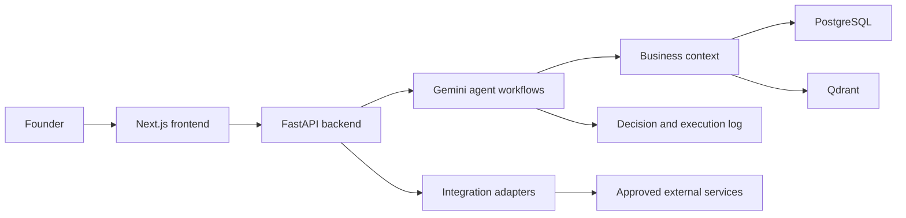

# AI Growth Agent

> Approval-gated AI growth orchestration for a Gemini-powered growth operating system.

## AI Builder Cup 2026 prototype

This public-safe competition copy targets **Future of Work & Enterprise Productivity**. Its
judge path is available at `/builder-cup` and demonstrates:

`sample SaaS evidence → Vertex decision → two evidence-linked actions → human approval → simulated execution record`

The competition path uses Firebase anonymous identity, a server-derived workspace, Firestore
workflow/quota/cache storage, and Gemini on Vertex AI. It never connects a judge to a real ad
account and the only executable competition action is explicitly simulated. A deterministic,
labelled fallback is returned when Vertex is unavailable; it is never presented as a live model
result.

The public workspace is explicitly sample-only. The **AI Decision Demo** is a competition-specific
addition, not a connected-account dashboard: its input is synthetic but its labelled Vertex result
is real model inference. English, Simplified Chinese and Traditional Chinese cover both evidence
and analysis, with separate language caches. Changing languages never approves an action. Public
Actions leads to this session-isolated workflow; private/local deployments retain the original
Live tools. The UI reads `/api/v1/capabilities` before restoring a saved workspace preference.

The public prototype is deployed at
[`https://reflected-jet-478308-t5.web.app/builder-cup/`](https://reflected-jet-478308-t5.web.app/builder-cup/).
Local verification and the deployed Google Cloud acceptance record are reported separately. See
[`docs/competition/IMPLEMENTATION_STATUS.md`](docs/competition/IMPLEMENTATION_STATUS.md) and
[`docs/competition/DEPLOYMENT.md`](docs/competition/DEPLOYMENT.md).

### Competition quick start

```bash
uv sync --locked --extra dev
uv run uvicorn backend.api.app:app --host 127.0.0.1 --port 8000
npm --prefix frontend ci
npm --prefix frontend run dev
```

Copy the two `.env.example` files to local untracked environment files and supply only your own
Firebase web configuration and GCP project settings. No API key is required for the Vertex path;
the backend uses Application Default Credentials or its Cloud Run service account.

## Status

Phase 5 adds a fixed AI Customer Support Startup case and a polished, presenter-controlled
three-minute Demo on top of the completed Phase 4/4.1 trust layer. The sequence is frozen as
Problem → Connect Data → AI Diagnosis → Agent Execution → Future. External growth actions remain
approval-gated, and Devpost submission materials remain outside scope.

## Vision

Give every early-stage company an always-on AI growth operator that can understand the business, identify the highest-leverage growth problem, recommend a plan, and—after explicit human approval—coordinate execution.

## Problem

Founders make growth decisions across disconnected systems: revenue data, ad platforms, customer feedback, product analytics, and internal plans. Existing dashboards describe what happened, but they rarely connect those signals into a prioritized decision or a safe, traceable action plan. Small teams therefore spend too much time reconciling data and too little time acting on the right opportunity.

## Solution

AI Growth Agent is designed as an agentic growth operating system. It will:

1. Build a unified company context from approved business data sources.
2. Diagnose growth constraints and explain the supporting evidence.
3. Produce a prioritized growth plan and budget recommendation.
4. Prepare or execute approved actions through connected tools.
5. Preserve an execution log so every recommendation and action is auditable.

The target demo flow is:

`Business inputs → Growth diagnosis → Founder briefing → Approved action → Execution log`

## Architecture

The Phase 0 architecture is organized around clear boundaries:

```text
frontend/       Founder-facing web experience (Next.js)
backend/        API, authentication, orchestration entry points (FastAPI)
agents/         Agent workflows (LangGraph), deterministic agents, optional Gemini narration
integrations/   External business-data and execution adapters
data/           Local demo fixtures and non-secret sample data
docs/           Product, architecture, operations, and submission notes
demo/           Demo scenario, scripts, and supporting assets
```

Planned platform services:

- PostgreSQL for application and audit data
- Qdrant for retrieval where semantic memory is justified
- Explicit approval gates before any external write action
- Structured execution logs for traceability



Phase 3 implements the founder experience on top of the orchestration and approval path. PostgreSQL and Qdrant
persistence remain planned platform services rather than implied runtime dependencies.

## Phase 1 capabilities

- `CompanyProfile` validation for the minimum business context
- Stripe read adapter for period revenue, paying customers, MRR, growth trend, and Revenue Momentum Score
- Google Ads read adapter for campaign spend, clicks, conversions, ROAS, CAC, trend, and health flags
- Meta Ads read adapter for campaign and creative metrics with the same normalized ad-health output
- Growth Score Engine V1 with the frozen formula:
  - Revenue Momentum: 30%
  - Marketing Efficiency: 30%
  - Market Demand: 20%
  - Execution Capability: 20%
- An injected Gemini structured-generation boundary for grounded narration; it cannot alter the rules score or execute actions
- A unified growth-intelligence service with interchangeable `demo` and `live` read-only data sources

Configuration, metric semantics, setup, and acceptance evidence are recorded in [`docs/PHASE_1.md`](docs/PHASE_1.md).

## Phase 2 capabilities

- LangGraph workflow: `Collect Data → Analyze → Call Agents → Generate Plan → Approval → Execute → Measure`
- Ads Agent campaign analysis with structured problem, reason, evidence, and recommendation
- CAC trend normalization and a grounded Creative Fatigue rule requiring multiple signals
- Reviewable Google Search campaign drafts with audience, keywords, creative, budget, and expected KPI
- Atomic Google Ads budget/campaign mutation that creates campaigns in `PAUSED` state
- Approval state machine with stale-payload protection and duplicate-execution prevention
- Founder natural-language input and a structured Top Problems → Actions → Expected Impact narrative
- Founder approval UI with Pending → Approve/Reject → Execute state rendering
- GEO Agent AI visibility score, competitor comparison, and three-step action plan
- Phase 3 handoff schemas for briefing/dashboard metrics

Architecture, API, safety invariants, and scope boundaries are recorded in
[`docs/PHASE_2.md`](docs/PHASE_2.md).

## Phase 3 capabilities

- Founder Daily Briefing home page with Growth Health, Revenue, Google Ads ROAS, AI Visibility,
  main risk, and Top Recommendation
- Growth Dashboard with Growth Score, Revenue, Marketing ROI, AI Visibility, and Customer Sentiment
- Phase 2 recommendation propagation into the dashboard and the exact approval workspace run
- Feedback Agent analysis for bounded Reddit/X inputs with problem, sentiment, evidence, and
  recommendation output
- Separate Customer Intelligence page showing auditable source signals
- Optional structured Gemini narration boundary that cannot change grounded metrics
- Persisted global Demo/Live workspace switch, with detailed provenance retained as accessible
  metadata instead of repeated visual badges
- A complete credential-free Demo journey that reaches the same founder review and approval flow

Page structure, API changes, demo data, and acceptance evidence are recorded in
[`docs/PHASE_3.md`](docs/PHASE_3.md).

## Phase 3.1 capabilities

- Unified neutral Prompt Runner for OpenAI Responses web search, Gemini Developer API Google
  Search, Gemini on Vertex AI Google Search, and Perplexity Sonar
- OpenAI visibility scans use `gpt-5.6-luna` with low-effort grounded search for predictable
  latency and cost
- Citation parsing, owned-domain detection, mention ranking, and a transparent Visibility Score
- Connection Center with encrypted tenant credentials, live tests, quota controls, and configured
  Google Ads/Meta Ads account selection
- One logical Gemini source with two mutually exclusive connection methods: AI Studio API key or
  Vertex AI Project ID, location, and API key/ADC. A visibility check never calls both.
- One global Demo/Live control that never substitutes synthetic output for a failed Live call
- X Recent Search and a compliant reddit.com-only Perplexity Search fallback
- Intercom real-brand acceptance scenario across Zendesk, Ada, and Forethought competitors
- Connection cards with one plain-language state (`Connected`, `Available`, or `Needs setup`) and
  advanced setup hidden behind a one-to-three-step connection flow
- Connection setup exists only in Live mode; Brand Visibility has its own page, while Demo remains
  a ready-to-present sample workspace and never asks for accounts, access keys, providers, or API
  configuration
- Explicit Live Dashboard refresh for Stripe, Google Ads, and Meta Ads; external reads only run
  after the founder clicks **Load live data**
- Live refresh failures name the exact source that needs attention; expired Google Ads access asks
  the founder to reconnect Google Ads rather than showing a generic data-source error
- Complete Brand Visibility and Customer Intelligence results are stored in separate Demo and Live
  history files, restored without another provider call, and compared against the prior check
- Observed result changes are associated with executed ledger actions between checks and clearly
  labelled as observational rather than causal
- Simplified production paths for Reddit, X, ChatGPT/OpenAI, both Gemini options, Perplexity,
  Google Ads, Meta Ads, and Stripe

Provider contracts, API changes, security limits, and real-brand verification are recorded in
[`docs/PHASE_3_1.md`](docs/PHASE_3_1.md).

## Phase 4 capabilities

- Append-only, concurrency-safe Agent Action Ledger with idempotent workflow-event recording
- Agent, action, reason, timestamp, and explicit execution status on every entry
- UTC timestamps in the API with automatic browser-local date, time, and timezone display in the UI
- Newest-first audit API with status filtering and bounded result limits
- Independent Demo and Live ledgers: reading Live history never initializes or returns Demo events
- Live business refreshes, visibility scans, and customer-feedback collections write only to the
  Live ledger; Demo approvals and sample agent activity write only to the Demo ledger
- Workflow and approval linkage for campaign execution, rejection, and failure outcomes
- Full-width Trust Layer section in the Founder Dashboard with contained narrow-screen scrolling
- Explicitly no blockchain, on-chain hash, token, wallet, or RWA implementation

Data contracts, API changes, runtime boundaries, UI placement, and acceptance evidence are
recorded in [`docs/PHASE_4.md`](docs/PHASE_4.md).

## Phase 5 capabilities

- One validated AI Customer Support Startup fixture: Team 5, MRR $30k, CAC rising, AI visibility low
- Exact Stripe → Google Ads → Meta Ads source story
- Exact 180-second five-stage presentation contract
- Story-led recording path across Daily Briefing, Growth Dashboard, Agent Actions, and Action Ledger
- Create Campaign and GEO Plan outputs that preserve approval and audit guardrails
- Growth Passport and Growth Capital closing cards explicitly labelled as future concepts
- Read-only deterministic Demo API with no workflow, provider, or ledger side effect

Data structure, timing, scope boundaries, and acceptance evidence are recorded in
[`docs/PHASE_5.md`](docs/PHASE_5.md).

## Trust & Governance Layer

The current Trust & Governance Layer provides an append-only Agent Action Ledger, explicit
execution status, approval linkage, and a founder-visible history of agent behavior. This gives
founders a clear record of which agent acted, what it did, why it acted, when it happened, and the
result. Demo and Live workspaces use separate in-memory ledger services and mode-scoped API reads,
so sample history cannot appear in a connected workspace.

Future roadmap support may include:

- **Hash verification** — verify that a stored audit event has not been altered after recording.
- **Blockchain anchoring** — optionally anchor audit proofs to an external chain for independent
  timestamp and integrity verification.

Phase 4 itself still does not create hashes for anchoring, write to a blockchain, issue tokens, or
implement RWA functionality. Phase 4.1 is a separately documented Testnet-only experiment: it
builds a deterministic Merkle root from one isolated ledger snapshot and anchors only that batch
proof. The Founder Dashboard now shows one compact verification state beside the ledger: the Demo
workspace links to its real Injective Testnet proof, while Live stays empty or unanchored until it
has its own activity and receipt. It does not publish raw records or change the accepted Phase 4
ledger contract. See
[`docs/PHASE_4_1.md`](docs/PHASE_4_1.md).

## Phase 1 acceptance demo

Run the deterministic synthetic case without credentials or network access:

```bash
.venv/bin/python -m demo.run_phase1 --mode demo
```

Expected headline output:

```text
Company: AI Customer Support Agent
MRR: 30000 USD
Google Ads ROAS: 2.8
Meta CAC: 120 USD
Growth Score: 68/100
Revenue Momentum: 80
Marketing Efficiency: 93
Data Source: demo
```

The same aggregation path can use configured read-only provider accounts:

```bash
.venv/bin/python -m demo.run_phase1 --mode live
```

`demo` loads `data/demo_ai_customer_support.json`. `live` loads the company profile and
collects Stripe, Google Ads, and Meta Ads snapshots using credentials from the ignored
local `.env` file. No provider write operation is implemented in Phase 1.

## Local verification

Python 3.11 through 3.14 are supported and tested in CI. With [uv](https://docs.astral.sh/uv/)
and the committed `uv.lock`:

```bash
uv sync --extra dev
uv run pytest
uv run ruff check .
```

Or with pip:

```bash
python3 -m venv .venv
.venv/bin/python -m pip install -e '.[dev]'
.venv/bin/python -m pytest
.venv/bin/python -m ruff check .
```

## Security configuration

| Variable | Effect |
|---|---|
| `API_ACCESS_TOKEN` | Every `/api` request must send `Authorization: Bearer <token>`. Without it the API answers only direct loopback clients; proxied or remote requests get `401`. |
| `API_PRINCIPAL_NAME` | Name recorded as the approver for token-authenticated decisions (default `founder`). |
| `PUBLIC_DEMO_ONLY` | `true` refuses Connections, Live refresh and every `mode=live` request, for hosted demos. |
| `CORS_ALLOW_ORIGINS` | Comma-separated frontend origins. |
| `FIREBASE_AUTH_REQUIRED` | `true` requires a valid Firebase ID token for API requests. Use this with `FIREBASE_PROJECT_ID` in the hosted competition environment. |
| `NEXT_PUBLIC_FIREBASE_*` | Public Firebase web-app identifiers used for anonymous sign-in. They are not backend credentials; authorization remains enforced by ID-token verification and Firestore rules. |

Run the Phase 2 offline acceptance flow:

```bash
.venv/bin/python -m demo.run_phase2 --decision pending
.venv/bin/python -m demo.run_phase2 --decision approve
```

Run the complete Phase 3 founder experience:

```bash
.venv/bin/python -m demo.run_phase3
```

Run the Phase 3.1 Intercom source-boundary and live-provider checks:

```bash
.venv/bin/python -m demo.run_phase31 --mode demo
.venv/bin/python -m demo.run_phase31 --mode live
```

Run the Phase 4 Agent Action Ledger flow:

```bash
.venv/bin/python -m demo.run_phase4 --decision pending
.venv/bin/python -m demo.run_phase4 --decision approve
.venv/bin/python -m demo.run_phase4 --decision reject
```

Run or export the Phase 5 fixed presentation script:

```bash
.venv/bin/python -m demo.run_phase5
.venv/bin/python -m demo.run_phase5 --json
```

Build and validate the optional Phase 4.1 Injective proof locally:

```bash
.venv/bin/python -m demo.run_phase41 --mode demo
.venv/bin/python -m pytest tests/test_phase41_audit_anchor.py -q
npm --prefix blockchain install
npm --prefix blockchain run contract:check
```

The read-only UI status endpoint is:

```text
GET /api/v1/audit-proof/status?mode=demo|live
```

Demo and Live resolve different receipt paths. A Live request never returns the Demo transaction,
root, or explorer link.

Run the approval experience:

```bash
.venv/bin/uvicorn backend.api.app:app --reload --port 8000
cd frontend && npm install && npm run dev
```

## Gemini usage

Gemini is used in two places today:

1. **Measurement.** Gemini (AI Studio or Vertex AI) with Google Search grounding is one of the
   answer engines the GEO Agent measures for brand visibility.
2. **Narration (opt-in).** With `GEMINI_NARRATION_ENABLED=true` and `GEMINI_API_KEY`,
   `integrations/gemini_structured.py` implements the `StructuredGenerator` boundary with
   `generateContent` and a JSON response schema. It writes the agent's reply to the founder and
   the Daily Briefing text from grounded facts only.

Workflow orchestration uses LangGraph. Scores, evidence, diagnoses and proposed actions are
deterministic and never come from the model; every model response is schema-validated, and any
Gemini failure falls back to deterministic text, so demos and tests stay reproducible. The
agent reply always addresses the founder's own message and says plainly when a topic (for
example churn or pricing) is outside the connected data.

## Repository policy

- This repository is the separate, public competition copy. It must never share Git history,
  remotes, credentials or private runtime data with the original private repository.
- Never commit credentials, API keys, customer data, or local environment files.
- Demo data under `data/` must be synthetic or explicitly approved for use.
- Run the checks in [`docs/competition/PUBLICATION_AUDIT.md`](docs/competition/PUBLICATION_AUDIT.md)
  before each public push.

## Phase 0 acceptance checklist

- [x] Project directory structure created
- [x] Technology direction and component boundaries recorded
- [x] README sections prepared for Devpost reuse
- [x] Local Git repository initialized
- [x] Independent public competition repository created and clean history pushed
- [x] Public repository can be read without reviewer invitations

## Phase 1 acceptance checklist

- [x] Company Profile model and example fixture added
- [x] Stripe, Google Ads, and Meta Ads read-only modules added
- [x] Provider data normalized into shared revenue and advertising snapshots
- [x] Growth Score Engine V1 implements the 30/30/20/20 formula
- [x] Gemini narration interface reserved without enabling agent execution
- [x] Offline provider and scoring tests added
- [x] Environment configuration documented without committing secrets
- [x] Unified demo case produces the frozen Phase 1 acceptance output
- [x] Demo/live data-source switching uses the same aggregation service
- [x] Live provider smoke tests passed with approved test-account credentials

## Phase 2 acceptance checklist

- [x] LangGraph workflow implements all seven frozen nodes in order
- [x] Ads Agent produces campaign analysis and a structured Google Search draft
- [x] Google Ads adapter can atomically create a paused budget/campaign pair
- [x] External execution is impossible while approval is pending or rejected
- [x] Approval is bound to the full action digest and cannot be replayed after changes
- [x] Approval UI displays action, budget, expected ROAS, and supporting draft details
- [x] GEO Agent reports AI visibility, competitors, reasons, and a GEO Action Plan
- [x] Phase 3 handoff contract is available without implementing Phase 3 features
- [x] Offline pending, approve, and reject paths are covered by tests
- [x] Exact founder demo story outputs CAC increase, Creative Fatigue, expected impact, and execution
- [x] Browser-verified UI displays the full diagnosis, approval, execution, and GEO story
- [x] Existing Phase 1 regression suite remains green

## Phase 3 acceptance checklist

- [x] Home page opens with Founder Daily Briefing and Growth Health
- [x] Revenue, Google Ads ROAS, AI Visibility, and Top Recommendation are visible above the fold
- [x] Dashboard exposes Growth Score, Revenue, Marketing ROI, AI Visibility, and Customer Sentiment
- [x] Phase 2 recommendation and pending approval state enter the dashboard
- [x] Feedback Agent accepts Reddit/X input and returns problem, sentiment, evidence, and recommendation
- [x] Customer Intelligence page shows the analyzed Reddit/X signals
- [x] No provider write occurs while the propagated action remains pending
- [x] Backend regressions, lint, frontend typecheck, and production build pass

## Phase 3.1 acceptance checklist

- [x] OpenAI, Gemini AI Studio, Gemini Vertex AI, and Perplexity grounded provider adapters added
- [x] Unified prompt, citation, mention-rank, and Visibility Score pipeline added
- [x] Connection Center exposes safe status, encrypted API-key setup, tests, and ad account selection
- [x] Demo and Live provenance is explicit on GEO and customer-intelligence results
- [x] X Recent Search and Reddit domain-filtered search fallback added
- [x] Credentials and quotas are tenant-namespaced; browser responses never include secrets
- [x] Intercom Demo and missing-credential Live boundary verified without fabricating a live score
- [x] Vertex AI global/regional routing, API-key/ADC authentication, and grounding citation parsing
  covered by tests

## Phase 4 acceptance checklist

- [x] Agent identity, action, reason, timestamp, and execution status are recorded
- [x] Ledger events are append-only and idempotent across repeated workflow delivery
- [x] Campaign execution and rejection events link to the originating workflow and approval
- [x] Founder Dashboard displays the Agent Action Ledger below the operating panels
- [x] Pending and rejected actions preserve the approval gate and make no provider write
- [x] Backend tests, lint, frontend checks, production build, and responsive browser QA pass
- [x] No blockchain, on-chain hash, token, wallet, or RWA capability is included

## Phase 5 acceptance checklist

- [x] Fixed case is AI Customer Support Startup with Team 5 and MRR $30k
- [x] Fixed problems are CAC rising and AI visibility low
- [x] Three-minute timeline uses the exact five required stages and boundaries
- [x] Demo data endpoint is deterministic and side-effect free
- [x] Real product pages carry the complete founder story without a demo-only navigation item
- [x] Create Campaign remains approval-protected and Future concepts are not presented as shipped
- [x] Phase 4/4.1 proof data remains unchanged and no Devpost material is created
